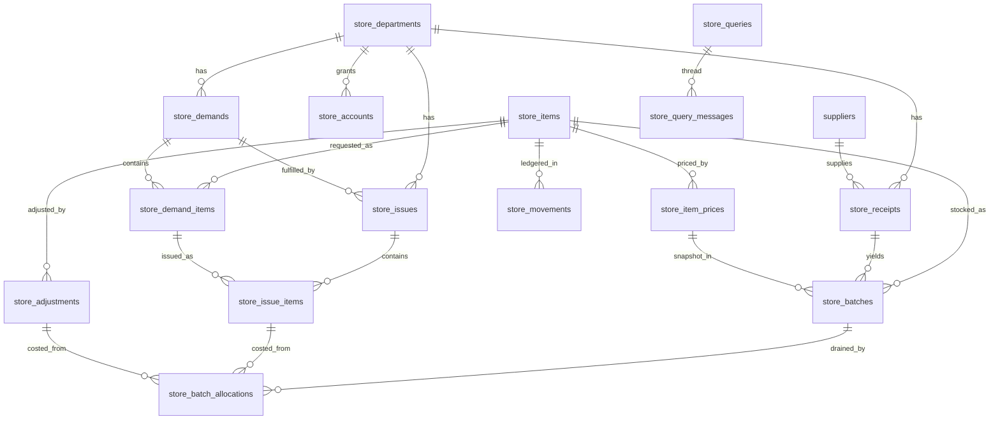

# Phase 0 — Discovery: Dry Items Store → Inventory & Stock System

**Status:** Draft for owner approval · **Date:** 2026-11-17 · **No code changes in this phase.**

This document maps the system as it exists today so Phases 1–7 can be planned against reality rather than assumptions. It is the gate for Phase 1: nothing is built until the owner approves it.

> **Headline finding:** the Dry Items Store is **already substantially built** — a batch/FIFO stock engine, an append-only ledger, demands, issues, adjustments, audit, idempotency and 11 web screens all exist. This program is **additive**, not a rebuild. Several things the master prompt lists as "to build" already exist (see §8 Gap list and §9 Reconciliation).

---

## 1. Method

Discovery was done read-only across the three repos under `D:\mountain\`, then every load-bearing claim below was confirmed against source (the store migration, `storeCan`, and the design tokens). Primary sources are cited inline by path.

---

## 2. Repo map, stack & deploy

| Repo | Role | Stack | Build & deploy |
|---|---|---|---|
| `mountainbakes-server` | REST API + Postgres | Node + `tsx`, Express, Prisma (client + hand-written SQL), Zod. Postgres 18. | `tsc --noEmit` typecheck; runs as `tsx server.ts`. **Railway** (nixpacks). Migrations applied **manually** via `pnpm exec prisma migrate deploy` — *not* on deploy, and `server.ts` does not migrate on boot. |
| `mountainbakes-frontend` | Web client | Next.js (static export, no SSR/route handlers), React, TanStack Query + Zustand, Tailwind, shadcn/ui, Recharts. | `next build` → `out/` → **Firebase Hosting**. |
| `mountainbakesMobile` | Mobile client | React Native (bare), Zustand + TanStack Query + Axios, `@op-engineering/op-sqlite` offline write-queue, React Navigation, Jest. Has basic stock screens. | Manual Android/iOS builds. |

**Shared contracts are duplicated.** `mountainbakes-server/src/shared` and `mountainbakes-frontend/src/shared` are hand-kept copies (`@mb/shared` → `./src/shared/index.ts` in the web tsconfig). Any shared type/schema change must be applied to **both**.

**Migration conventions (critical):** hand-written additive SQL at `prisma/migrations/<yyyymmddhhmmss>_<name>/migration.sql`; business functions live in the `app` schema, data in `public`; statuses are `TEXT` + `CHECK` (never enums, so they stay additive); IDs via `app.next_store_number(key, prefix, width)`. Never `prisma migrate dev` / `db push` (they would drop functions/triggers).

---

## 3. Store database schema

Source: `prisma/migrations/20261110000002_dry_items_store/migration.sql` (+ `20261110000001_store_role_enums`). Money is `numeric(14,2)`, quantities `numeric(14,3)`, unit costs `numeric(14,4)`. Timestamps `timestamptz` (UTC); business date via `app.karachi_business_date()`.

| Table | Key columns | Notes |
|---|---|---|
| `store_departments` | `store_code` (DRY-STORE-001), `name`, `opening_date`, `is_active` | **Singleton** — one "Dry Items Store" row seeded. No per-location model today. |
| `store_accounts` | `user_id`, `store_id`, `can_manage_items`, `can_edit_prices`, `can_adjust_stock`, `can_issue` | Per-keeper permission switches (role `store_user`). |
| `store_lookups` | `kind ∈ {category, base_unit, purchase_unit, adjust_reason}`, `value`, `sort_order`, `is_active` | Pick-lists, unique on `(kind, lower(value))`. Seeded categories/units/reasons. **No unit `type` or conversions, no parent/sub-category.** |
| `store_items` | `item_no` (DRY-001), `item_code` `^[A-Z0-9-]{2,12}$`, `name`, `category`, `base_unit`, `purchase_unit`, `conversion_qty`, `min_stock`, `available_qty`, `status`, `remarks`, `purchase_item_id` | `available_qty` is **written only by `app.store_move`**; `CHECK available_qty >= 0`. Unique `lower(name)` and `item_code`. |
| `store_item_prices` | `price_no` (PRC-0001), `item_id`, `package_name`, `package_qty`, `price` (per package), `effective_from`, `status` | Effective-dated; new rows only, never edited. One active per `(item, package, qty, date)`. |
| `store_receipts` | `receipt_no` (RCV-000001), `supplier_id → public.suppliers`, `supplier_name`, `invoice_no`, `total_amount`, `client_request_id` | A `suppliers` table **already exists** (shared with WhatsApp Purchasing). |
| `store_batches` | `batch_no` (BAT-000001), `item_id`, `source ∈ {receipt, opening, adjustment, return}`, `receipt_id`, `price_id`, `package_*`, `list_price`, `price_per_package`, `override_reason`, `unit_cost`, `received_qty`, `remaining_qty`, `amount`, `supplier_batch_no`, `expiry_date`, `received_at` | FIFO source of truth. `remaining_qty` is the only mutable field; `CHECK 0 ≤ remaining ≤ received`. Partial index `store_batches_fifo_idx (item_id, received_at, created_at) where remaining_qty > 0`. **Expiry already tracked.** |
| `store_demands` | `demand_no` (DRD-000001), `demand_date`, `required_date`, `requested_by*`, `production_code`, `status ∈ {pending_review, ready_to_issue, issued, received, rejected, cancelled}`, `client_request_id` | Production's request. |
| `store_demand_items` | `line_no`, `item_id`, `requested_qty`, `status ∈ {pending, approved, rejected, issued}`, `approved_qty`, `issued_qty`, `received_qty`, `unit_price`, `decision_note` | Partial approval allowed; reject needs a note (CHECK). `issued ≤ approved`. |
| `store_issues` | `issue_no` (ISS-000001), `demand_id`, `issued_by*`, `received_by_name`, `status ∈ {issued, received, received_with_difference}`, `confirmed_*`, `total_cost`, `client_request_id` | Issue slip; Production confirms receipt. |
| `store_issue_items` | `issue_id`, `demand_item_id`, `item_id`, `issued_qty`, `received_qty`, `cost_amount` (FIFO), `unit_price` | |
| `store_adjustments` | `adj_no` (ADJ-000001), `item_id`, `kind ∈ {adjustment, opening, return}`, `direction ∈ {in, out}`, `qty`, `reason`, `business_date`, `value`, `client_request_id` | `CHECK (kind='adjustment' OR direction='in')`. **`return` kind + `in` direction already exist as hooks**, but no Production-return UI/flow. |
| `store_batch_allocations` | `batch_id`, `item_id`, `issue_item_id` XOR `adjustment_id`, `qty`, `unit_cost`, `amount` | FIFO drain ledger: which batch paid for each issue/out-adjustment. |
| `store_movements` | `item_id`, `type ∈ {opening, receipt, issue, adjustment, return}`, `qty_delta` (≠0), `balance_after`, `value`, `business_date`, `ref_no`, source FKs (`receipt_id/batch_id/issue_id/demand_id/adjustment_id`) | **The ledger.** Append-only; written only by `app.store_move`. `balance_after >= 0`. |
| `store_queries` | `query_no` (SQ-000001), `subject`, `query_type` (8 values), `status ∈ {open, in_review, responded, resolved, rejected}`, related RCV/DRD/ISS FKs, `archived_at` | Store help-desk. |
| `store_query_messages` | `query_id`, `author_side ∈ {store, production, admin}`, `body`, `status_change` | Threaded. |
| `store_audit_events` | `entity ∈ {item, price, receipt, demand, issue, adjustment, account, settings, query}`, `entity_id`, `action`, `before_data`/`after_data` (jsonb), `actor_*` | Append-only audit; full before/after. |

### ER diagram

---

## 4. Stock engine (how balances actually work)

All in the store migration (`app.*` functions). **There is no `stock_balances` materialised view** — balances are cached and ledger-derived:

- **Available** = `store_items.available_qty`, kept equal to Σ `store_batches.remaining_qty`. Written **only** by `app.store_move`, which locks the item row (`SELECT … FOR UPDATE`), rejects any move that would take the balance below 0 (`P0001`), updates `available_qty`, and inserts one `store_movements` ledger row. This is the single choke-point for every quantity change.
- **Committed** = `app.store_committed(item)` = Σ `(approved_qty − issued_qty)` over `store_demand_items` where `status='approved'` and the demand is not cancelled.
- **Free** = Available − Committed (computed at read time).
- **FIFO issue** = `app.store_drain_fifo(item, qty, issue_item, adjustment)`: selects open batches `ORDER BY received_at, created_at, batch_no FOR UPDATE`, takes oldest-first, decrements `remaining_qty`, writes one `store_batch_allocations` row per batch touched, and returns the summed cost. Raises `P0001` if batches are short. (This is also the hook point for a future **FEFO** option — ordering by `expiry_date` instead.)
- **Unit price / valuation** = `app.store_unit_price(item, day)` = active price of the item's **largest** package ÷ its qty; `app.store_price_state()` resolves active/scheduled/superseded/inactive on a date.
- **Numbering** = `app.next_store_number(key, prefix, width)` — `counters` upsert, zero-padded, no SEQUENCE (gap-free per series). Existing prefixes: DRY-STORE, DRY, PRC, RCV, BAT, DRD, ISS, ADJ, SQ. New modules add PO-, SUP-, CNT-, TRF-, RTN-, PCK- the same way.

**Concurrency & idempotency** are already handled: `store_move` locks the item row and `drain_fifo` locks batches, so two concurrent issues can't oversell; every stock-moving POST carries an `Idempotency-Key` (see §5).

---

## 5. API & services

**Routes:** `src/routes/store.routes.ts`, all under `/api/store`, each gated by `can(<StoreAction>)` and (for stock-moving POSTs) `idempotent(<key>)`. **Services:** `src/services/store/{catalog,stock,demands,queries,reports,common}.service.ts`.

| Area | Endpoints (method path — gate) |
|---|---|
| Session/settings | `GET /me` (view) · `GET/POST /lookups`, `PATCH /lookups/:id` (accounts) · `PUT /settings` (accounts) · `GET /accounts`, `PUT /accounts/:userId` (accounts) · `GET /audit` (accounts) |
| Items | `GET /items` (view) · `POST /items`, `PUT /items/:id`, `PATCH /items/:id/status` (items.edit) · `DELETE /items/:id` (items.delete) · `GET /items/:id/history|ledger|batches` (view) · `GET /items/export` (view) · `POST /items/import/preview|commit` (items.edit) |
| Prices | `GET /prices` (view) · `POST /prices` (prices.edit, idempotent) · `POST /prices/:id/deactivate` (prices.edit) |
| Receiving/stock | `GET /suppliers` (receive,view) · `GET /receipts`, `GET /receipts/:id` (view) · `POST /receipts` (receive, idempotent) · `GET /stock` (view) · `GET/POST /adjustments` (view / adjust, idempotent) |
| Demands/issues | `GET /demands`, `/demands/counts`, `/demands/:id` (view,demand.create) · `POST /demands` (demand.create, idempotent) · `POST /demands/:id/cancel` · `POST /demands/:id/approve-all`, `POST /demand-lines/:lineId/decision` (demand.review) · `GET /issues`, `/issues/:id` · `POST /issues` (issue, idempotent) · `POST /issues/:id/confirm` (issue.confirm) |
| Queries | `GET /queries`, `/queries/:id` · `POST /queries` (queries.raise, idempotent) · `POST /queries/:id/messages` · `DELETE /queries/:id` (queries.admin) |
| Dashboard/reports | `GET /dashboard` (reports) · `GET /reports/:type`, `GET /reports/:type/export` (reports) |

Note the item **Excel import/export** endpoints already exist (`buildItemExportRows` / `parseItemImport` / `commitItemImport`) — a template for the prompt's bulk-import-with-preview requirement.

---

## 6. Roles & permissions

Source of truth: `storeCan(role, action, flags)` in `src/shared/types/store.types.ts` (server enforces it; UI only hides buttons). `StoreAction` = view, items.edit, items.delete, prices.edit, receive, receive.override, adjust, opening, demand.create, demand.review, issue, issue.confirm, queries.raise, queries.admin, reports, accounts.

| Role | Can |
|---|---|
| `super_admin` | **everything** |
| `store_user` (keeper) | always: view, receive, demand.review, queries.raise, reports · by account flag: items.edit (`canManageItems`), prices.edit (`canEditPrices`), adjust (`canAdjustStock`), issue (`canIssue`) |
| `finance_admin`, `finance_manager` | view, reports, **prices.edit** |
| `accountant`, `finance_auditor` | view, reports |
| `production_user` | view, demand.create, issue.confirm, queries.raise (no store pages of its own; uses `/production-dry-demand`) |

`STORE_VIEW_ROLES` = super_admin, store_user, finance_admin, finance_manager, accountant, finance_auditor. Defaults: `canManageItems/adjust/issue = true`, `canEditPrices = false`. **There is no Store Manager role today** (the prompt proposes one — owner sign-off needed).

---

## 7. Design tokens & shared UI

Tokens in `src/app/globals.css` (OKLch; confirmed): `--primary: oklch(0.702 0.187 41.5)` ≈ **#F97316 orange**; `--background: oklch(0.978 0.018 88)` cream; `--secondary: oklch(0.35 0.09 47)` brown; `--sidebar: oklch(0.25 0.07 47)` dark brown; `--radius: 0.625rem` (10px). Light + dark modes and a `data-accent` switch (blue/green/purple) all present. **Fonts (`src/app/layout.tsx`): Geist** (`--font-sans`, desktop) and **Urbanist** (`--font-urbanist`, a phone-redesign layer) — *not Inter*.

Reusable building blocks (extend, don't rebuild):
- **`DataTable`** (`src/components/shared/DataTable.tsx`): TanStack table — sorting, server paging/search, `columnVisibility`, `dense` mode, mobile card layout, skeletons, empty state. **Missing:** sticky *first* column, a column-chooser UI, and exposed bulk row-selection.
- **`src/components/store/parts.tsx`**: `StorePage` (tabbed page frame + permission guard), `Kpi`, `Card`, `Pill` (tones amber/blue/green/red/muted), `DateRange` (Today/Yesterday/Last 7/This month/Custom), `FilterSelect`, `Segmented`, `Field`, `Fact`, and formatters `rs()`, `num()`, `qty()`, `rate()`, `fd()`, `fdt()`.
- **Data layer:** `src/lib/store.ts` hooks (reads + idempotent-keyed writes), all invalidating the `['store']` root; keys in `src/lib/queryKeys.ts`.
- **Charts:** Recharts (used in `src/components/finance/dashboard/FinanceCharts.tsx`) — ready for the analytics row.
- **Export/PDF:** `saveBlob` + `exceljs` (store exports live) and `pdfkit` (`src/services/export.service.ts` renders branded order PDFs — extendable to PO/GRN/issue-slip/labels).

The 11 store screens today: Dashboard, Items, Prices, Receiving, Stock, Approval & Issue, Ledger, Reports, Queries, plus admin-only Accounts and Settings (`src/components/store/*`, routed under `/store-*`, nav in `src/utils/sidebar.ts`).

---

## 8. Gap list (prompt → reality)

**§1 problems to fix (Phase 1):**

| # | Problem | State | Note |
|---|---|---|---|
| 1 | Low-stock KPI contradicts out-of-stock | **partial** | Dashboard + Stock exist; no single shared low/out definition; out-of-stock not counted as low. |
| 2 | Committed shows `-` vs `0 Piece` | **partial** | Formatters exist; zero rendering inconsistent across screens. |
| 3 | Receiving hard-blocked when no active price | **partial** | Block exists; **"Request price" flow missing**; no `PRICE_PENDING` receipt. |
| 4 | Categories hard-coded / mis-filed | **partial** | `store_lookups` manages categories but no CRUD UI, no sub-category; mis-filing is data cleanup. |
| 5 | Unit list mismatch (Carton) | **partial** | Units are lookups (Carton seeded) but have **no type or conversions**. |
| 6 | Inconsistent name casing | **partial** | `lower(name)` uniqueness exists; no Title-Case display normalization. |
| 7 | Tall rows, wide tables, no frozen cols | **partial** | `dense` exists; **sticky first column + column-chooser UI missing**. |
| 8 | Two near-duplicate dashboard cards | **exists→merge** | Cards exist; merge into one with a secondary line. |
| 9 | Returned column, no return flow | **partial** | Schema hooks exist (`adjustment.kind='return'`, `movement 'return'`); **no RTN- UI/flow**. |
| 10 | Free-text supplier + "Other" | **partial** | `suppliers` table + `supplier_id` FK exist; **store supplier master (SUP-), dedupe & migration missing**. |

**§6 modules:** Dashboard v2 **partial** (no charts/PO tiles) · Items v2 **partial** (no image/barcode/reorder/packages/costing fields) · Suppliers **partial** (table exists; master UI + `supplier_items` + migration missing) · Purchase Orders **missing** · Receiving v2 **partial** (base exists; PO/variance/price-request missing) · Stock on hand v2 **partial** (no locations/on-order/days-of-cover/expiry columns) · Adjustments v2 **partial** (reason lookup exists; batch-level + approval thresholds missing) · Stock counts **missing** · Transfers **missing** · Approval & Issue v2 **partial** (FIFO + approval exist; availability matrix/pick list/partial-issue UI/dots missing) · Returns from Production **missing** (schema hooks present) · Price Control v2 **partial** (effective-dated exists; bulk/approval/chart missing) · Stock Ledger v2 **partial** (ledger exists; month timeline/type filter/source links missing) · Reports v2 **partial** (10 reports + export exist; ABC/valuation-as-of/expiry/variance/supplier-perf/budget missing) · Alerts **partial** (notifications exist; inventory-specific alerts/digests missing) · Audit **partial** (`store_audit_events` exists; per-document Activity tab UI missing).

---

## 9. Reconciliation: prompt vs reality

- **Font** is Geist/Urbanist, not Inter. **Primary** is **#F97316**, not #F26B2A.
- **Ledger is `store_movements`** (append-only via `app.store_move`); balances are **cached** on `store_items.available_qty` + batch `remaining_qty`. The prompt's `stock_transactions` + `stock_balances` matview would be **new names for an existing design** — reuse `store_movements`, don't fork it.
- **No feature-flag system exists** (prompt ground-rule 11) — to be built in Phase 1 (`store_features` + `can('feature.X')`).
- **Single store, item-level balances.** No locations/bins today (`store_departments` is a singleton). Multi-location is **deferred** (see decisions).
- **Tests are thin:** server `node --test` + PGlite (`src/db/__tests__`), web Vitest, **no e2e**. The prompt's heavy test matrix (incl. concurrency and ledger-reconciliation) needs new harness work, Playwright added in Phase 7.
- **A generic `audit_logs` + `logAudit()`** exists for admin actions, alongside the store's per-entity `store_audit_events`.
- Several "new" items are **already present or hooked**: batches + expiry, FIFO + allocations, idempotency, issues, adjustments with a `return` kind, Excel item import/export, `suppliers` table, `pdfkit`.

---

## 10. Risks & open questions (resolve at the relevant phase gate)

- **Multi-location (biggest fork).** Turning on per-location stock re-keys every balance by `(item, location, batch)` and touches `store_move`/`drain_fifo` and every read. **Decision taken:** design location-ready (nullable `location_id` + a `locations` table) but keep single-store live — no history rewrite.
- **Store Manager role** — add it? Needs owner sign-off + `storeCan` expansion.
- **Thresholds** owner must set: price-variance approval %, adjustment approval value, near-expiry windows (7/30/60).
- **Costing default per item** (FIFO vs FEFO when expiry tracked) and **PO approval chain** (which role approves).
- **Supplier reality:** a `suppliers` table is shared with WhatsApp Purchasing — confirm whether the store supplier master extends it or is distinct before building SUP-.
- **Docs location:** this doc lives in `mountainbakes-server/docs/inventory-upgrade/`; confirm that's the home for all phase reports (vs a cross-repo root).
- **Shared-type duplication** means every contract change lands in two repos — a standing source of drift to watch.

---

## 11. Decisions locked & next gate

Locked with the owner for this program: **(1)** this discovery doc is the first deliverable, then stop; **(2)** locations deferred but designed location-ready; **(3)** add a lightweight feature-flag mechanism; **(4)** server + web first, mobile in a later phase.

**Next gate:** owner reviews this document against the live app (`https://mountainbakes-dfc2c.firebaseapp.com/`). On approval, Phase 1 begins — fix the 10 problems in §1, add the shared status-map / KPI / table upgrades, and build the `store_features` flag mechanism — delivered with `docs/inventory-upgrade/PHASE-1-REPORT.md`.
